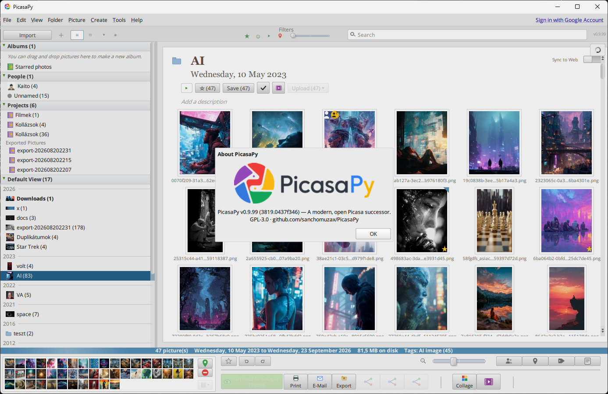

<p align="center">
  
</p>

<p align="center"><em>Photo management and editing inspired by Google Picasa.</em></p>

<p align="center"><strong>Miért csinálom ezt? Olvasd el a Substack-en: <a href="https://substack.com/@sanchomuzax/p-211538466">https://substack.com/@sanchomuzax/p-211538466</a></strong></p>

<p align="center">
  <a href="https://github.com/sanchomuzax/PicasaPy/actions/workflows/ci.yml"></a>
  <a href="LICENSE"></a>
  <a href="https://github.com/sanchomuzax/PicasaPy/releases"></a>
  
</p>

<p align="center">
  
</p>

<p align="center"><a href="#english">English</a> · <a href="#magyar">Magyar</a></p>

# English

## What is PicasaPy?

PicasaPy is an open-source photo manager and editor built with Python, PySide6, and Qt Quick. It is designed as a modern successor to Google Picasa and reads and writes the same `.picasa.ini` format, so both applications can work with the same photo folders. PicasaPy updates the modification time of edited photos so a running Picasa can refresh them, but Picasa may overwrite external edits the next time it writes its own changes. The shared format therefore does not provide conflict-safe live synchronization.

## Features

- **Library management and browsing:** scan and watch folders, browse albums and collections, search and filter photos, import from folders or removable devices, organize files, and manage stars, captions, and tags.
- **Photo viewer:** view photos and videos, move between items, and run slideshows.
- **Editor and effects:** make non-destructive edits stored in `.picasa.ini`; crop and straighten photos, remove red eye, retouch, add text overlays, adjust light and color, and apply image effects.
- **Metadata, faces, and places:** read photo metadata and write captions to image files; detect and group faces, assign names, and view or edit geotags on a map.
- **Export and sharing:** export edited photos and videos, create HTML galleries and XMP sidecar files, and prepare photo attachments in the system email application.
- **Movies, collages, and printing:** create movies from photos and compose collages; print photos and contact sheets or split an image across pages for a poster.

## Installation and running

- **Windows:** download the `PicasaPy-Setup-….exe` installer from [Releases](https://github.com/sanchomuzax/PicasaPy/releases) and run it. Python is not required.
- **Linux:** run PicasaPy from source, as described below.

### Run from source on Linux

Install Git and Python 3.12 or newer, then run:

```bash
git clone https://github.com/sanchomuzax/PicasaPy.git
cd PicasaPy
sudo apt-get install -y $(python3 scripts/print_dependencies.py --apt)
python3.12 -m venv .venv
source .venv/bin/activate
python -m pip install .
picasapy ~/Pictures
```

### Run from source on Windows

Install Git and Python 3.12 or newer, then run these commands in PowerShell:

```powershell
git clone https://github.com/sanchomuzax/PicasaPy.git
cd PicasaPy
py -3.12 -m venv .venv
.\.venv\Scripts\Activate.ps1
python -m pip install .
picasapy "C:\Users\felhasznalo\Pictures"
```

The `picasapy` command opens the photo folder passed to it. The package dependencies are declared in `pyproject.toml` and are installed by `pip install .`.

## Documentation

Project specifications are in [`docs/specs/`](docs/specs/), and design decisions are in [`docs/decisions/`](docs/decisions/). Version-specific changes are listed in the [CHANGELOG](CHANGELOG.md).

## Contributing

See [`CONTRIBUTING.md`](CONTRIBUTING.md) for the development setup and contribution guidelines.

## License

PicasaPy is licensed under [GPL-3.0](LICENSE).

# Magyar

## Mi a PicasaPy?

A PicasaPy nyílt forráskódú fotókezelő és képszerkesztő Python, PySide6 és Qt Quick alapokon. A Google Picasa modern utódjának készül, és ugyanazt a `.picasa.ini` formátumot olvassa és írja, így a két program ugyanazokkal a fotómappákkal használható. A PicasaPy a módosított képek fájlidejét is frissíti, hogy a már futó Picasa észlelhesse a változást, de a Picasa egy későbbi saját írásakor felülírhatja a külső módosításokat. A közös formátum ezért nem jelent ütközésbiztos, élő szinkronizálást.

## Funkciók

- **Könyvtárkezelés és böngészés:** mappák beolvasása és figyelése, albumok és gyűjtemények böngészése, keresés és szűrés, importálás mappákból vagy cserélhető adathordozóról, fájlrendezés, csillagok, feliratok és címkék kezelése.
- **Néző:** fényképek és videók megtekintése, léptetés közöttük és diavetítés indítása.
- **Szerkesztő és effektek:** nem destruktív módosítások mentése a `.picasa.ini` fájlba; vágás és kiegyenesítés, vörösszem-javítás, retusálás, szöveg ráhelyezése, fény- és színbeállítások, valamint képeffektek.
- **Metaadatok, arcok és helyek:** fotómetaadatok olvasása és képfeliratok fájlba írása; arcok felismerése és csoportosítása, elnevezése, valamint geocímkék megtekintése és szerkesztése térképen.
- **Exportálás és megosztás:** szerkesztett fényképek és videók exportálása, HTML-galériák és XMP-kísérőfájlok készítése, valamint fényképek előkészítése a rendszer levelezőprogramjához.
- **Filmek, kollázsok és nyomtatás:** fényképekből film készítése és kollázsok összeállítása; fényképek és indexképlapok nyomtatása, illetve poszter több lapra bontása.

## Telepítés és futtatás

- **Windows:** töltsd le a `PicasaPy-Setup-….exe` telepítőt a [Releases](https://github.com/sanchomuzax/PicasaPy/releases) oldalról, és indítsd el. Pythont nem kell külön telepítened.
- **Linux:** a PicasaPy forrásból futtatható, az alábbiak szerint.

### Futtatás forrásból Linuxon

Telepítsd a Gitet és a Python 3.12-es vagy újabb változatát, majd futtasd:

```bash
git clone https://github.com/sanchomuzax/PicasaPy.git
cd PicasaPy
sudo apt-get install -y $(python3 scripts/print_dependencies.py --apt)
python3.12 -m venv .venv
source .venv/bin/activate
python -m pip install .
picasapy ~/Pictures
```

### Futtatás forrásból Windowson

Telepítsd a Gitet és a Python 3.12-es vagy újabb változatát, majd PowerShellben futtasd:

```powershell
git clone https://github.com/sanchomuzax/PicasaPy.git
cd PicasaPy
py -3.12 -m venv .venv
.\.venv\Scripts\Activate.ps1
python -m pip install .
picasapy "C:\Users\felhasznalo\Pictures"
```

A `picasapy` parancs a megadott fotómappát nyitja meg. A futáshoz szükséges Python-csomagokat a `pyproject.toml` sorolja fel; a `pip install .` telepíti őket.

## Dokumentáció

A projekt specifikációi a [`docs/specs/`](docs/specs/) mappában, a tervezési döntések a [`docs/decisions/`](docs/decisions/) alatt találhatók. A kiadásonkénti változásokat a [CHANGELOG](CHANGELOG.md) sorolja fel.

## Közreműködés

A fejlesztői környezet és a közreműködés tudnivalóit a [`CONTRIBUTING.md`](CONTRIBUTING.md) ismerteti.

## Licenc

A PicasaPy a [GPL-3.0](LICENSE) licenc alatt érhető el.
