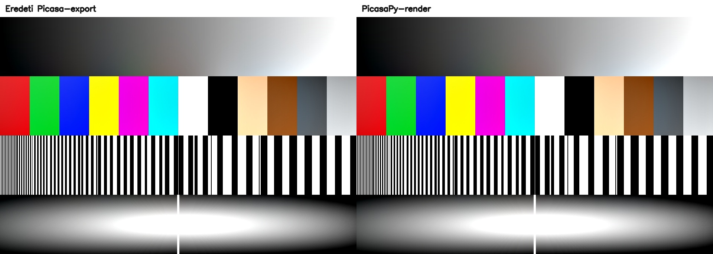

# #5279: a láncparaméterek és az ismeretlen tag mérése

**Időpont:** 2026-10-18 02:40 és 02:43 között, Europe/Budapest  
**Kódállapot:** `c668968b9` + a munkafa #5279-es módosításai (nem commitolt)  
**Gép:** AArch64, 4× Cortex-A76, 15 GiB RAM  
**Terhelés előtte / utána (1 / 5 / 15 perc):** 2,17 / 3,15 / 5,42 · 1,68 / 2,93 / 5,26  
**Egyéb futás:** e mérés közben nem futott pytest párhuzamosan ebben a munkamenetben; a gép egyéb folyamatait nem leltároztam.

## Módszer

A helyi mérőadat-archívumból csak a három forrásképet és a hozzájuk tartozó
eredeti Picasa-export JPEG-et bontottam ki ideiglenesen a `.tmp/5279/` alá;
az összes kibontott fájlt a mérés után töröltem.
A PicasaPy-képet a `parse_filters_prefix` + `apply_filters` renderlánc adta.
A színes képeket RGB `uint8` formában hasonlítottam össze a
`tools/golden/analyze_validation_kit.py` `mean_de` függvényével: képpontonkénti
CIE76 ΔE átlaga. Mindhárom pár 960×640 képpont; átméretezés nem történt.
Minden determinisztikus esetet háromszor mértem.

## Eredmények

| Minta | Lánc | 1. ΔE | 2. ΔE | 3. ΔE | Eredmény |
|---|---|---:|---:|---:|---|
| `dir_brite__alap` | `dir_brite=1,0.500000,0.500000;` | 0,234705 | 0,234705 | 0,234705 | megfelel (≤ 2,0) |
| `dir_sharp__alap` | `dir_sharp=1,0.500000,0.500000;` | 0,494193 | 0,494193 | 0,494193 | megfelel (≤ 2,0) |
| `B_ismeretlen_elol` | `nincsilyen=1;bw=1;` | 0,180723 | 0,180723 | 0,180723 | megfelel (≤ 2,0); az olvasó üres ép előtagot ad, a `bw` nem fut le |

Az eredmény a `filters-decoded.md` irányított effekt-szakaszának kétcsúszkás
alakjával egyezik. A `filterdesc-registry.md` általános puck-sorrendjéhez
hozzáírtam a három irányított natív effekt kivételét: itt a puck állítja a
csúszkákat, de az x/y értékek nem részei a mentett láncnak. A #4233-as
hiányos mező kezelése továbbra is pontos aritást követ.

## Képi összevetés

