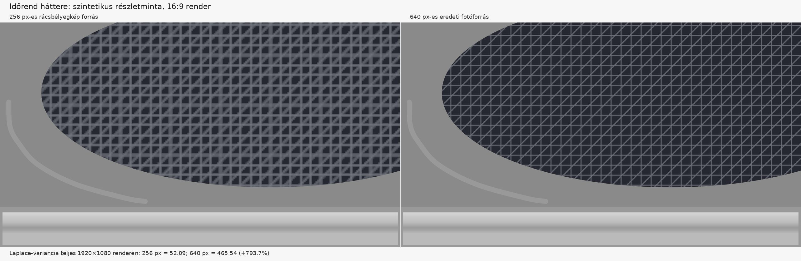

# #6604: az Időrend-háttér forrásának élessége

## Módszer

Egy 1280×960 képpontos, szintetikus, finom rács- és átlómintából két változat készült: a régi 256 px-es rácsbélyegkép és a fotóból kicsinyített 640 px-es forrás. Mindkettőt a meglévő Időrend-háttérláncon futtattam át 1920×1080 képpontos kimenetre. A mérés az ovális fedőrétegen belüli, szöveg nélküli `x=350:1450`, `y=250:650` képkivágás szürkeárnyalatos `cv2.Laplacian(..., CV_64F).var()` értéke.

## Eredmény

| Forrás | Laplace-variancia |
|---|---:|
| 256 px-es bélyegkép | 52,09 |
| 640 px-es fotóforrás | 465,54 |

A 640 px-es forrás mért értéke **793,7%-kal magasabb** ezen a szintetikus mintán. Ez összehasonlító élességmérés, nem valós fotókra vonatkozó minőségi ígéret.

